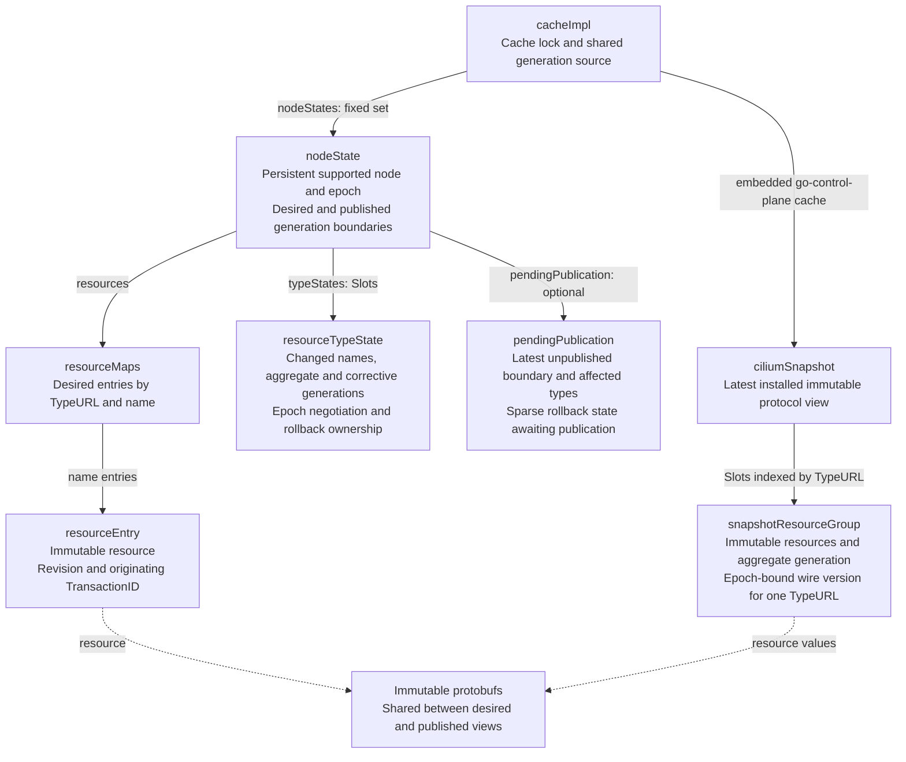
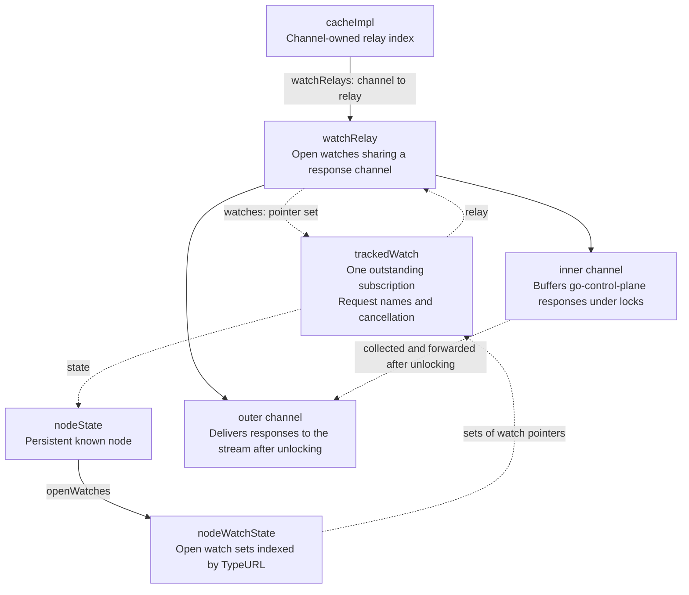
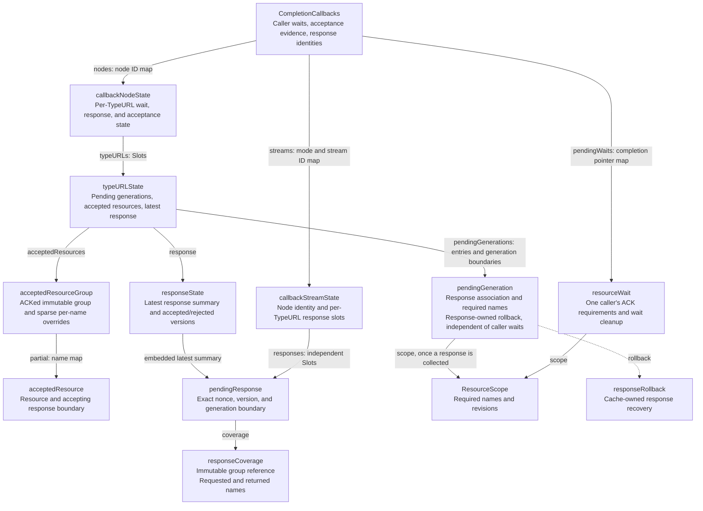
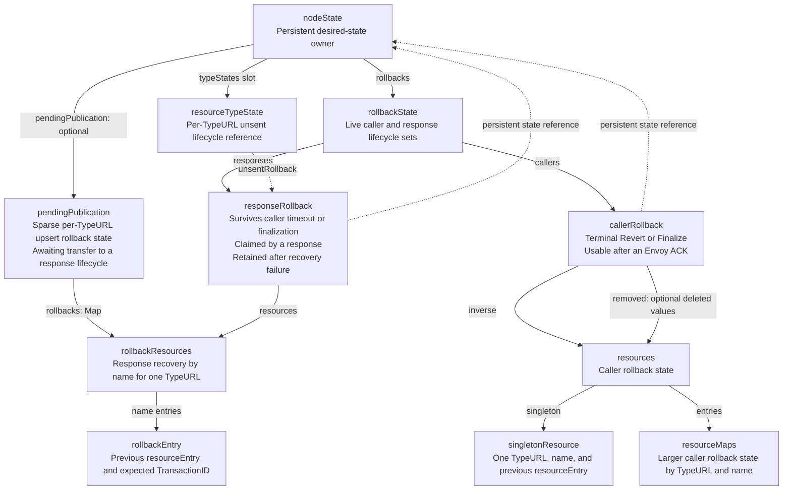

# ADS xDS cache state, publication, and rollback

## Overview

The ADS xDS cache extends go-control-plane's SnapshotCache to manage the resources
Cilium wants Envoy to use. It commits desired state, coalesces unpublished changes,
and retains sparse rollback state for updates which opt into caller and Envoy
NACK recovery. This state contains the previous resource entries needed to undo
changes. A matching watch triggers snapshot publication; go-control-plane
constructs and delivers protocol responses.

```text
Cilium update → desired state → snapshot → response → ACK/NACK
                       │                       │
                caller lifecycle       response-owned rollback
```

There are three distinct resource views:

| View | Meaning |
| --- | --- |
| Desired | The resources Cilium currently wants Envoy to use. |
| Published | The latest immutable snapshot installed in go-control-plane. |
| Accepted | Resources acknowledged by Envoy, tracked by name for partial responses. |

Publication alone proves neither delivery nor acceptance. Caller rollback and
response rollback have independent lifetimes: finalizing a caller transaction
must not prevent a later Envoy NACK from correcting the cache.

## Principal invariants

- Supported nodes are fixed at construction. Their state persists even with no
  resources or streams; requests and mutations never create nodes.
- Desired state is cache-private and mutable. Protobufs and published snapshots
  are immutable and may be shared.
- Mutations, rollback selection, and publication are serialized under the cache
  lock. Response delivery and caller wait completion run after unlocking.
- Mutations commit desired state before returning. Unpublished changes coalesce
  until a matching watch can consume a snapshot. Semantic no-ops preserve the
  cached protobuf and do not force publication.
- ACKs prove acceptance only for the resource names and revisions communicated
  by their response.
- NACK recovery reverts opted-in, still-current upserts of the rejected resource
  type and names communicated by that response. Caller rollback covers its
  transaction's upserts and removals while preserving superseding API changes.
- NACKs cannot undo removals. Caller rollback may restore the values captured
  atomically when deleting them. Desired state contains only live resources.
- Rollback state remains only while live lifecycles need it.

## API and locking

`ApplyResource` takes a resource type, name, and protobuf; nil removes the resource.
`ApplyResources` accepts sparse transactions containing Listeners (LDS), Routes
(RDS), Clusters (CDS), Endpoints (EDS), and Secrets (SDS). NetworkPolicies (NPDS) and
NetworkPolicyHosts (NPHDS) use the single-resource API, so one transaction cannot
mix Listener and NetworkPolicy changes.

Plain mutation APIs commit non-revertible changes. A NACK can fail their caller
waits but leaves their resources in desired state. This protects programmatically
generated resources when a response also includes rejected CEC resources.

Callers may supply a WaitGroup to wait for Envoy's response. Bulk calls select
the resource types to wait for explicitly; an empty selection creates no waits.
The `WithRollback` variants enable independent response-owned NACK recovery for
changed upserts and return a non-nil caller rollback on success. Semantic changes
get a caller lifecycle, on which the caller eventually invokes either `Revert()`
or `Finalize()`. Semantic no-ops get a shared, stateless no-op handle; synchronous
errors return nil.
Caller rollback undoes eligible upserts and removals atomically. Resources absent
before deletion are not reinserted.

ADS `UpdateEnvoyResources` uses these variants for CEC/CCEC changes and owns its
ACK waits and recovery. When the new resources include Listeners, it waits for
LDS and any supplied CDS resources. On wait failure it invokes caller rollback;
after success it finalizes the caller handle. The CEC reconciler confirms port
allocations only after this call succeeds. During restoration it skips these
internal waits and finalizes after admission,
retaining response-owned NACK recovery. Ordinary waits run outside the server
lock. Address-changing listeners require a serialized delete-and-recreate sequence.

A plain semantic no-op also adopts the existing value as non-revertible. Its
protobuf, revision, transaction ID, and published snapshot remain unchanged.
Older caller and response rollbacks cannot undo the adopted value, and later
rollback targets retain it when bypassing rejected predecessors. Adoption occurs
only after successful admission, including for unchanged members of a mixed
transaction.

ADS admin and metrics listeners immediately finalize any returned caller rollback
handle after admission, retaining response-owned NACK recovery. They do not
participate in redirect reference counting. Canceling a caller wait leaves the
listener configured; an Envoy NACK can still remove it.

Redirect listeners use non-revertible updates. After successful proxy waits,
endpoint regeneration explicitly acknowledges their ports and installs datapath
redirection rules. Failure releases the failed redirects' references; only the
last reference can reset an unacknowledged proxy-managed allocation. Static and
CEC-owned ports retain their separate ownership rules.

Endpoint regeneration and incremental policy updates record proxy policy
acceptance after their proxy wait succeeds, using the revision submitted before
the wait. Initial cache seeding does not report acceptance.

A transaction holds the cache write lock while preparing and committing its
changes and performing any immediate publication. Readers cannot observe partial
changes. Completion registration and Listener-derived policy-wait bookkeeping use
the same lock. Response delivery and caller wait completion are deferred until
after unlocking.

## State and ownership

Each supported node has a persistent `nodeState`. It owns desired resources,
publication boundaries, epoch negotiation, open watches, and node-local rollback
ownership. Per-resource-type state groups changed names, aggregate and corrective
generations, and rollback ownership. Desired and published generation boundaries
can differ while changes await publication. The node's epoch and identity persist
across stream disconnects; lifecycles retain their node reference for later
resolution.

Node-local rollback state manages caller and response lifetimes and adjusts
rollback targets after a NACK. `CompletionCallbacks` owns caller ACK waits,
accepted-resource evidence, and response identities. Acceptance evidence retains
the relevant immutable resource group and sparse per-name overrides. Multiple
streams keep independent response identities for the same node and resource type.

The diagrams show state retained between calls, requests, and responses, omitting
temporary transactions and delivery batches. Solid arrows show containers and
their contents; dashed arrows show cross-references or shared values. `Slots` and
`Map` are fixed containers indexed by resource type.



## Updates and removals

Under the cache lock, a transaction:

1. Compares proposed resources with desired state. Semantic no-ops keep the
   existing protobuf, revision, and transaction ID.
2. Prepares changes and ACK waits for names whose desired state is not accepted.
3. Reserves a generation if resources change, then commits desired entries,
   records changed names, and registers ACK waits.
4. Coalesces response-owned rollback state for opted-in upserts into the pending
   publication. Response-owned recovery never retains removals.
5. Publishes a snapshot if a directly affected watch is open.
6. Creates a requested caller lifecycle after a successful commit or publication.

Invalid input leaves desired state unchanged. If immediate publication fails
before installation, the transaction restores its previous entries and pending
state and detaches its waits. A failed apply returns no caller lifecycle.
A delivery error after installation preserves the committed update.

Referenced resources may arrive in separate transactions. The cache does not
require every referenced resource to exist or reject unreferenced Routes and
Endpoints. Missing ClusterLoadAssignments (CLAs) for EDS Clusters are synthesized
as empty assignments in the snapshot without inserting them into desired state.

### Generations, revisions, and transactions

Every state-changing mutation reserves a number from a cache-wide generation
source. Three roles distinguish how that number is used:

- `Generation`: a mutation number or a snapshot/response boundary.
- `Revision`: when a named value last changed, whether by an API call or revert.
- `TransactionID`: the API transaction which originally inserted that value.

API changes assign the same number to the resource's revision and transaction ID.
Reverts restore the previous value and transaction ID but assign a fresh revision.
Ordering across these roles relies on their shared source. Failed attempts can
leave gaps in the sequence, which is never rewound.

Snapshot and response boundaries can include several API transactions and
reverts. ACK evidence must identify the required resource name and revision within
the acknowledged response.

In `A → B → A`, the two API changes to A have different transaction IDs and
revisions even when their contents match. An older rollback cannot undo the later
A. Restoring A through a revert also gives it a fresh revision, so a delayed ACK
for B or the original A cannot complete a wait for restored A.

## State coalescing

Unpublished changes are already committed to desired state. Pending publication
holds the necessary state for incremental snapshot publication and possible
rollback: publication generation boundary, affected resource types, and rollback
state.

Before a response claims rollback state, repeated changes to one name coalesce to
the oldest previous value and the latest expected API transaction:

```text
desired changes: P0 → P1 → P2 → P3
rollback state: previous=P0, expectedTransaction=transaction(P3)
```

A desired removal or non-revertible upsert ends its name's unpublished or unsent
rollback chain. A later revertible upsert uses that desired value as its baseline,
including absence after a removal. A net no-op chain can also discard its response-owned rollback
state. Once a response claims that state, it stops coalescing; subsequent updates
begin another chain.
Returning desired state to the original value cannot discard a sent response's
rollback state, because Envoy may still NACK it. Caller rollback remains
independently owned in either case.

## Snapshot publication

A successful mutation commits desired state before returning, but only publishes
a snapshot if a directly affected watch is open. Otherwise, changes coalesce
until a matching request arrives. An unrelated watch does not trigger publication.

Known nodes start with empty desired state. Their first supported active
subscription creates and publishes the initial snapshot from current desired
state, including resources of other types. An empty resource group is supplied
only when that type's desired state and any required synthesized assignments are
empty.

New snapshots shallow-copy the previous snapshot and replace affected resource
groups. Immutable resource maps are cloned only where entries change. Missing
CLAs are synthesized in the snapshot. Generation-based versions make snapshot
construction independent of serialization and content hashing. Marshaling is
deferred to go-control-plane's response construction. Only SotW snapshots are
supported.

Publication metadata becomes visible only after successful installation. The
published generation advances, and pending publication bookkeeping and changed
names are cleared; independent rollback ownership remains intact.

If publication triggered by `CreateWatch` fails, desired state and pending
publication remain available for another attempt or caller rollback. Response
construction can still fail to encode a resource after a successful cache mutation
or publication.

### Wire versions and EDS replay

Wire versions use `e<epoch>:g<generation>`, for example `e1:g42`. The epoch
distinguishes the restarted agent's generation sequence from versions retained by
a running Envoy. Internally the cache keeps bare generations and binds the node's
epoch when publishing a snapshot. Each resource type's aggregate generation
advances for changes and reverts, ensuring restored values receive a new wire
version too.

The first active subscription for each resource type contributes its reported
epoch, if any. Versions without an `e<positive integer>:` prefix are ignored.
The initial node epoch is the smallest positive integer absent from that
subscription's reported versions. If another type's first active subscription
reports that selected epoch, negotiation advances beyond all initial epochs
recorded for the node. This handles Envoy retaining different epochs for different
resource types across agent restarts.

Negotiated types retain continuity across reconnects. Changing the epoch updates
the published protocol view without publishing unrelated pending changes.

A Cluster change can require fresh EDS delivery even when desired CLAs are
unchanged: Envoy may need it to finish warming with an already-subscribed EDS name,
or the snapshot may gain or lose synthesized empty assignments. In these cases,
the EDS wire generation advances to the greater of its current generation and the
CDS generation. Desired EDS revisions and transaction IDs remain unchanged.
LDS changes do not artificially advance RDS, CDS, or SDS versions.

## Delivery and ACK processing

Cache relays buffer responses produced synchronously by `SetSnapshot` or
`CreateWatch`. Before delivery, the cache captures their exact publication
generation, the resource names they communicate, and rollback ownership.
Immediate `CreateWatch` responses are captured under the lock too; their
generations are never inferred from later publications or newly registered waits.
Collected response batches are delivered outside the lock, with parents before
children within each batch.



Open watches are tracked both by node and resource type, and by response channel.
Both tracking structures refer to the same watch objects. One ADS stream maintains
a current watch per resource type with its requested names; different streams may
have independent named subscriptions. Relay state lives only while its watches do.

Requests for unsupported resource types from known nodes call the embedded
go-control-plane cache directly. Published resources are limited to supported
types. Requests for unsupported types with an empty version remain unanswered
until cancellation; a nonempty version may receive an empty response.

Named-resource coverage identifies the names whose state a response communicates,
including deletions where omission signals removal. Each stream keeps its own
response identity per resource type. `OnStreamResponse` records the response's
generation and named-resource coverage. Envoy supplies the corresponding ACK or
NACK in a later request, matched by stream and nonce. A matching ACK can complete
the associated waits; NACK handling depends on whether they require upserts or
only removals. Coverage retains the delivered resource group, so later
publications cannot change which values an ACK accepts.

An ACK acknowledges only the names communicated by the response identified by
the nonce. For types supporting deletion by omission (LDS, CDS, NPDS, NPHDS), this
can include names within its subscription which are absent from the response. A
multi-name wait succeeds only after every required name has been acknowledged.
A repeated removal still requires valid ACK evidence despite retaining no
desired entry. An older response containing the live resource cannot satisfy it.
An ACK releases response-owned rollback once all of its required names have been
acknowledged. Names from one API generation can have separate response-owned
lifetimes.



### Semantic no-op waits

A semantic no-op does not allocate a generation or caller rollback state. With a
WaitGroup, it checks acceptance of the specific resource:

- Already accepted contents complete immediately, even if another name of the
  same type is pending.
- Pending state waits for a response communicating that name and revision.
- A known NACK for that state can fail the wait immediately.

Bulk waits retain only names whose desired contents are not already accepted.
Changing one resource does not cause waits on unchanged, ACKed resources.
If no published baseline exists, waits register against desired revisions and
acquire their wire version at publication; a no-op does not force publication just
to register a wait. Removing a resource from a node which has never held resources
completes immediately. Restored absence uses the type's latest corrective
generation without retaining absent resource entries.

### Listener-derived policy waits

The ADS-supplied `ListenerObserver` counts desired Listeners starting an NPDS
client. This tracking runs under the cache lock and must not take the ADS server
mutex or call the cache. NACK reverts are counted; bulk replacement exposes only
its net Listener-count change.

Under the same lock, a NetworkPolicy update without NPDS Listeners stores desired
state but immediately satisfies its caller wait. Removing the last NPDS Listener
detaches existing node-scoped NPDS waits before unlocking and completes them
afterward. Completing these waits leaves acceptance evidence and rollback
ownership unchanged.

## NACK recovery

A NACK rejects the resource type and names communicated by its response. The
cache selects their opted-in, still-current upserts and leaves non-revertible
resources, desired removals, other types, and unrequested names unchanged, even
within one bulk API transaction.
Unrequested names remain available to coalesce with later changes.

NACK recovery uses the ordinary cache transaction. The cache lock prevents caller
mutations and other NACKs from interleaving. The selected rollback targets are
composed into one corrective mutation before publication, so no intermediate
correction can be delivered. Successful recovery releases the selected
response-owned rollback state. A recovery that changes desired resources commits
one corrective generation and publishes it when a matching watch can consume it.
Response delivery and caller wait completion run afterward.

Rollback targets are adjusted to bypass rejected values of the affected names.
If A is rejected after B replaces it, B remains desired, and its later rollback
restores the value preceding the rejected A. This also applies to caller rollback
after B is ACKed. Rollback stores no history beyond these live lifecycles.

Failed immediate publication leaves desired state unchanged and retains response-owned
rollback state for a later response. Other rollback targets still bypass rejected
predecessors: rejection is definitive even if corrective publication fails.
Waits covering rejected upserts receive the original NACK, and the recovery error
closes the stream. An ACK can release retained recovery state. The cache has no
background retry loop.

## Rollback ownership and lifetime

The caller eventually invokes exactly one lifecycle method:

- `Finalize()` releases its rollback state without changing desired resources.
- `Revert()` restores upserted entries only while their API transaction IDs match the
  transaction being undone. It also restores eligible removals, as described below.
  It returns any error and releases caller ownership whether it succeeds or fails.

Both calls are terminal. Duplicate calls warn and do nothing.
Stateless no-op handles own no recovery state and may be invoked repeatedly.

Successful API reuse of a live value prevents an earlier caller from reverting
that value. Repeating a removal similarly invalidates earlier restoration claims.
Only the affected names lose caller recovery; other changes in the earlier
transaction remain eligible. These rules apply before or after ACK, without
changing revisions, ACK waits, or response-owned NACK recovery. A caller handle
remains valid until resolved, even if all its recovery has been superseded.

`callerRollback` and `responseRollback` have independent lifetimes. An Envoy ACK
can precede a wider caller failure, so caller rollback remains usable after ACK.
Caller cancellation, timeout, or early finalization cannot consume response-owned
rollback state. Response-owned rollback state also survives failed recovery.



### Removals and rollback lifetime

Successful admission removes the desired entry. A NACK leaves that removal intact,
even when another upsert from the same transaction is reverted. Admission ends
the name's unpublished and unsent response-recovery chains; a later upsert starts
from absence. A failed admission restores the previous desired state.

A caller lifecycle retains the actual deleted value from the deleting transaction.
Caller rollback restores it only while the name is absent and no newer API
deletion has superseded the claim. Even deleting an already absent name supersedes
older claims, preventing an add/delete sequence from making an old rollback
actionable again. A NACK can rebase a saved value so caller rollback cannot
resurrect rejected state. No removed entry remains in desired state.

A resource-type wait requiring only removals remains pending after a NACK until
a later ACK communicates the required state or its WaitGroup's context ends. Mixed
upsert/removal waits for the rejected type retain ordinary NACK failure handling.
Upserts of other types in the same transaction do not make its removal-only wait
fail. As with other coalesced waits, a later ACK can resolve a superseded removal.
Responses need no new cache mutation to retry: after a NACK, Envoy requests its
last accepted version again.

New removal waits after a NACK conservatively require ACK evidence at least as
new as the latest rejection for that type. This prevents subsequent NACKs from
reviving older absence evidence without retaining deletion history.

SotW LDS/CDS/NPDS/NPHDS communicate deletion by omission. EDS/RDS/SDS omission
does not delete a resource, so its ACK cannot satisfy a removal wait. Envoy may
retain that configuration while a parent references it. Removing a CLA still
referenced by a cached Cluster projects a named, empty CLA, which can satisfy
the wait when ACKed. A NACK still leaves the desired CLA absent.

ACK waits retain their revision requirements separately from desired state and
rollback lifecycles. A removal using a `WithRollback` API needs caller resolution
even after its ACK wait completes; plain removals need no caller lifecycle.

## Stream disconnect, reconnect, and startup

Disconnect cancels that stream's watches and removes its response identity.
Desired state and recovery payloads persist. Sent, unacknowledged rollback loses
the dead stream/nonce association but remains frozen; unsent rollback remains
coalescible. Other live streams keep their state. When the last stream closes,
acceptance evidence is cleared because reconnect might involve a fresh Envoy
process.

A reconnecting node can receive retained generations again. Acceptance requires
named-resource coverage and an ACK matched to the delivered response.

Before the first connection, repeated changes to one name retain the absent or
oldest baseline and the latest expected API transaction. Caller finalization does
not remove response-owned rollback state, so an initial NACK can remove applicable
resources created during startup.

Repeated response/disconnect cycles without outcomes can retain several frozen
lifecycles. A later response can resolve the generations it communicates together.

## Code organization

- `cache.go`: API transactions, snapshot construction/publication, and delivery.
- `resources.go`: resource containers, prepared changes, and input validation.
- `node_state.go`: persistent desired state, pending publication, epoch negotiation,
  and node-local bookkeeping.
- `rollback.go`: caller and response lifecycles, coalescing, and rebasing.
- `callbacks/`: response identities, named-resource coverage, accepted state,
  ACK waits, NACK coordination, and stream lifecycle tracking.

Cache API/lifecycle tests use the mutation APIs; watch and named-response tests
drive real go-control-plane responses and stream callbacks. Shared test fixtures
centralize cache construction and response delivery without adding test hooks to
production code.
